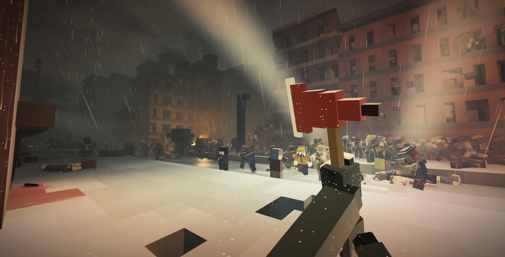
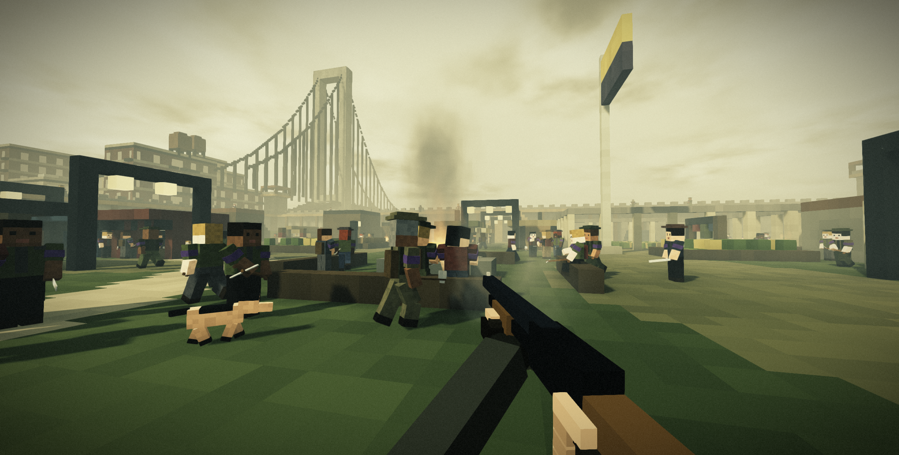
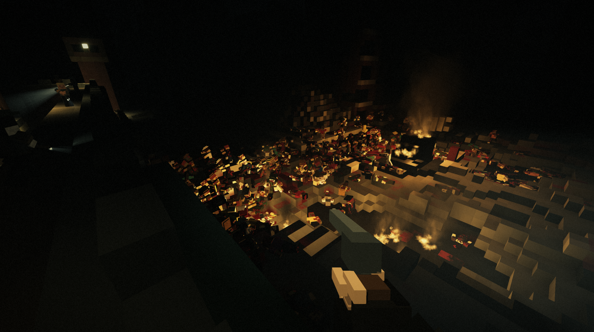
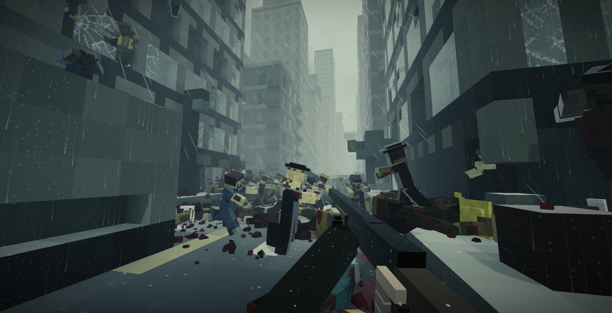

# Spadeheart: NPC-driven voxel zombie survival

Prototype built with Claude, playable in browser:
https://ignatiushewett.github.io/spadeheart/

Or play it in its own window, no browser: download the repository and double-click `Spadeheart.bat` (Windows, needs [Node.js](https://nodejs.org)). The first run sets it up once.

